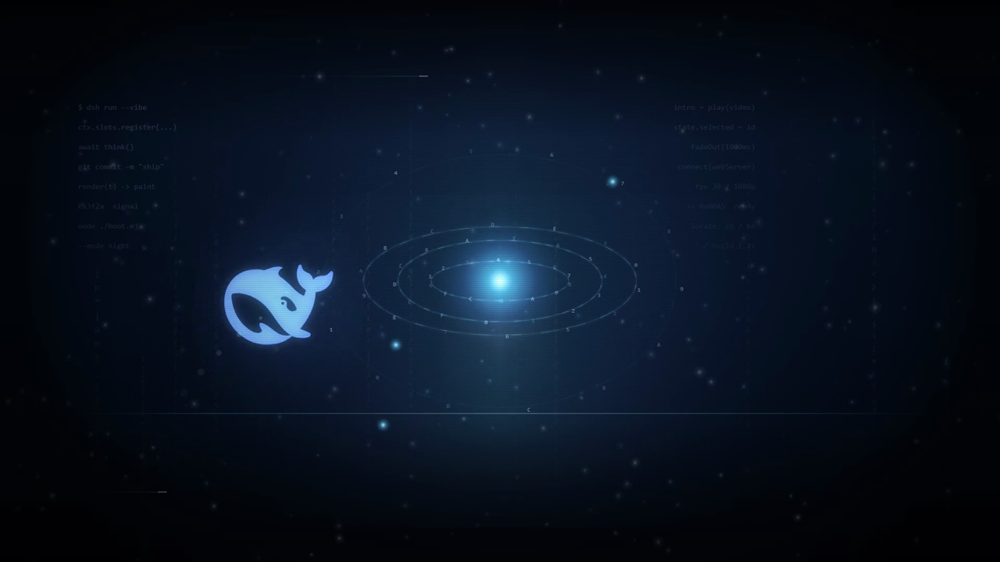
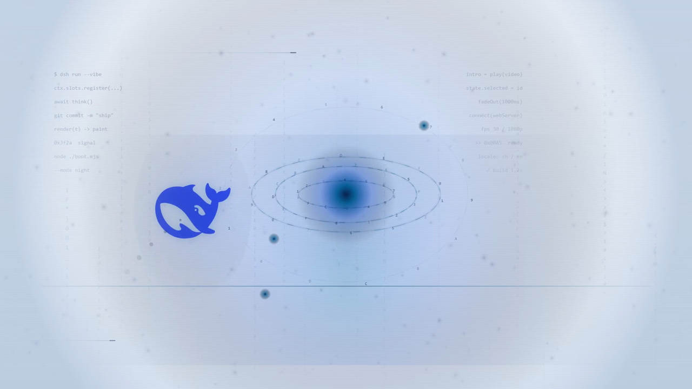
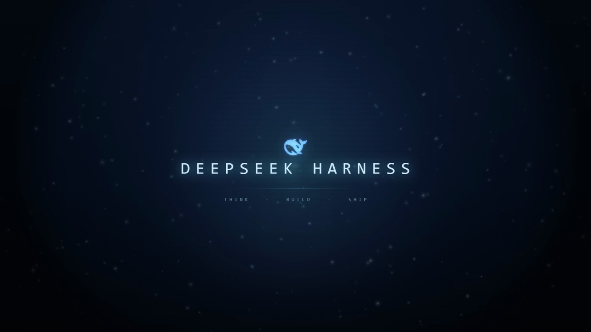
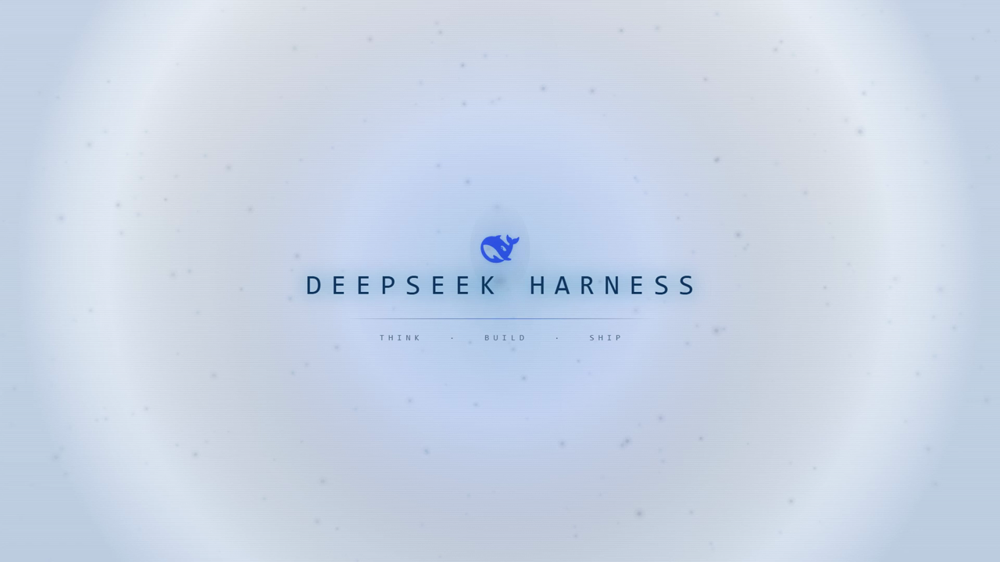
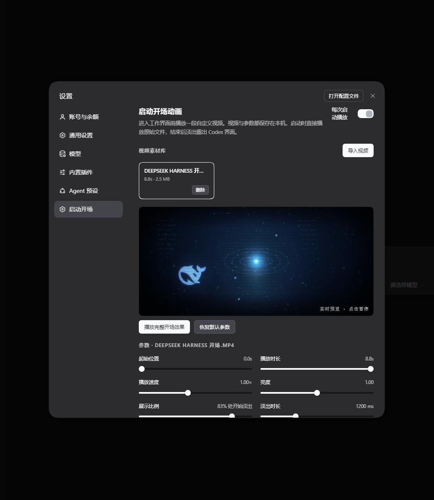
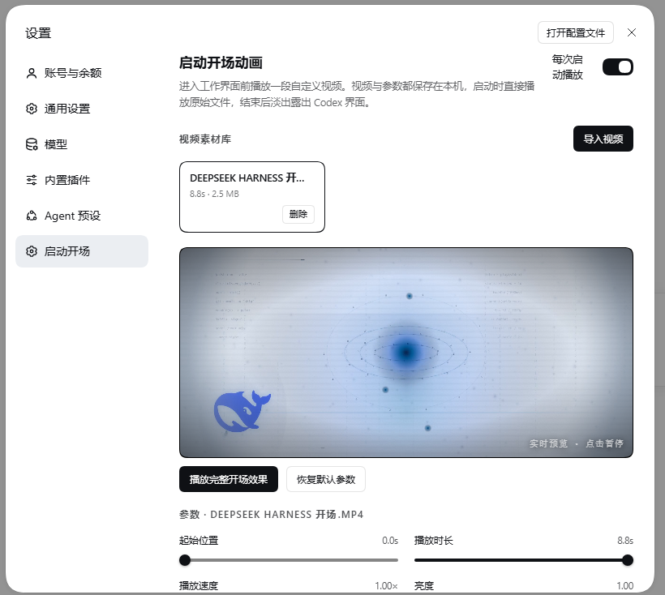

# DSH Startup Intro · 启动开场动画

给 [DeepSeek Harness](https://github.com/deepseek-ai) 加一个可自定义视频的启动开场：导入自己的视频素材，选中哪段，之后每次启动就播哪段；片段、速度、亮度、画面适配、影院填充、展示比例与淡出时长都能调，支持实时预览；播完交叉淡出，直接过渡到工作台。动画还会**跟随 DSH 的浅色 / 深色外观自动选版**。

A video-powered boot intro plugin for DeepSeek Harness: import clips, keep per-clip playback settings, preview live in Settings, then cross-fade into the workbench at every launch. Ships with a procedurally generated demo intro (dark & light cuts).


<p>
  
  
</p>
<p>
  
  
</p>
<p>
  
  
</p>

## 功能

- **视频素材库**：导入本地视频（`mp4` / `webm` / `mov` 等 Chromium 能解码的格式），删除、切换选中；每段素材各自保存一套参数。
- **启动即播**：直接播放原视频（不做 GIF 转换、不重新编码），播完约 0.8–1.2s 交叉淡出露出 DSH 界面；播放中可点击「跳过开场」。
- **参数调节**：起始位置、播放时长、播放速度、亮度、画面适配（铺满 / 完整）、影院填充（用同一段视频的模糊背景补满画面）、展示比例（播到哪一刻开始淡出）、淡出时长、静音。
- **实时预览**：设置页内嵌预览随参数即时变化；「播放完整开场效果」可在全屏跑一遍完整启动流程。
- **深浅色自动切换**：跟随 DSH 的外观（`body[data-ds-dark-theme]`）自动选择深色版 / 浅色版同一素材；设置页预览也会随外观实时换版。
- **数据都在本机**：素材与参数保存在 `~/.dsh/startup-intro/`，卸载插件不会删除素材。

## 安装

先确认 `dsh` 可用（DeepSeek Harness 自带 CLI，Electron 桌面版安装目录 `resources/runtime/cli/bin/dsh.cmd`）。

### 方式一：目录安装（推荐）

```bash
git clone https://github.com/zoe1nan/dsh-startup-intro.git
dsh plugin --profile desktop add /path/to/dsh-startup-intro
```

### 方式二：打包安装

```bash
pnpm pack            # 或 npm pack，得到 dsh-startup-intro-1.1.0.tgz
dsh plugin --profile desktop add /path/to/dsh-startup-intro-1.1.0.tgz
```

> 若 pnpm 报 `[ERR_PNPM_UNKNOWN] ... open '.../pnpm/store/...'`，改用目录安装即可绕过（本地 link 依赖）。

安装完成后**重启 DeepSeek Harness**（Electron 桌面版重启才会加载新 bundle）。打开 设置 → 启动开场 即可看到插件页面。

## 使用

1. 设置（`Ctrl+Alt+,`）→ 左侧「启动开场」。
2. 点「导入视频」，选择本地视频；导入后自动选中，下次启动就播放它。
3. 调整参数——右侧预览实时生效；点「播放完整开场效果」可在全屏看完整流程。
4. 右上「每次启动播放」可临时关闭开场；「恢复默认参数」重置当前素材。

## 预置演示素材

`demo/` 下是两段程序化生成的示例开场（1920×1080 / 8.8s / 30fps，各 2–3 MB）：

| 文件 | 用途 |
| --- | --- |
| `demo/startup-intro-dark.mp4` | 深色外观版：深蓝夜空 + 轨道环 + 原生小蓝鲸 |
| `demo/startup-intro-light.mp4` | 浅色外观版：纸面蓝墨 + 同构图的墨色鲸 |

一键写入本机素材库并选中：

```bash
node tools/seed-demo.mjs
```

也可以直接在设置页「导入视频」里选这两个文件。生成源码见 `demo/source/intro-art.html`（`?t=<ms>` 可定位到任意帧，`&theme=light` 输出浅色版）。

## 深浅色自动切换

素材条目支持可选的 `lightFile` 字段（同一素材的浅色版）：

```jsonc
// ~/.dsh/startup-intro/state.json
{
  "version": 1,
  "enabled": true,
  "selectedId": "v9f2b7c4e1a8d3605c7be",
  "videos": [
    {
      "id": "v9f2b7c4e1a8d3605c7be",
      "name": "DEEPSEEK HARNESS 开场.mp4",
      "file": "v9f2b7c4e1a8d3605c7be.mp4",
      "lightFile": "v9f2b7c4e1a8d3605c7be-light.mp4",
      "meta": { "duration": 8.8, "width": 1920, "height": 1080 },
      "params": {
        "start": 0, "duration": 8.8, "speed": 1, "brightness": 1,
        "fit": "cover", "cinema": true,
        "holdRatio": 0.83, "fadeMs": 1200, "muted": true
      }
    }
  ]
}
```

把浅色版文件放进 `~/.dsh/startup-intro/media/`，并在对应条目加上 `lightFile` 即可：深色外观播 `file`，浅色外观播 `lightFile`。不填 `lightFile` 时两种外观播放同一文件。

## 实现

```
index.js               Host 半边：状态 / 上传 / 删除 / 媒体直出路由
client.js              Client 半边：启动浮层（shell.overlay）+ 设置页（settings.section）
cordis.patch.yml       bundle 挂载声明
locale/{zh,en}.json    设置页导航与插件卡片的标题 / 描述
icon.svg               插件图标
demo/                  示例开场素材与生成源码
tools/seed-demo.mjs    把 demo 素材写入本机素材库
```

- Host：`ctx.webServer.register({ kind: 'prefix', path: '/startup-intro' })` 提供
  `GET/POST /api/state`、`POST /api/upload`、`POST /api/delete`、`GET /media/<file>`（支持 `Range` / 206）。
  所有请求都会先过 `connection.requestRejection(req)`，未授权直接 401。
- Client：`ctx.slots.inject('shell.overlay', ...)` 注册启动浮层（`createPortal` 到 body，保证盖过启动弹窗）；
  `ctx.slots.inject('settings.section', ...)` 注册设置页。用 `MutationObserver` 监听 `body[data-ds-dark-theme]` 切换素材版本。
- 不使用插件 Config 字段：素材与参数放 `~/.dsh/startup-intro/state.json`，由设置页自己读写。

## 开发与调试

不想污染现有 profile 时，可以起一个独立测试实例：

```bash
# 用内置模板建一个独立 profile（与 desktop 隔离）
dsh introtest --from-default-profile web --dump-config
dsh plugin --profile introtest add /path/to/dsh-startup-intro

# 启动测试实例（--no-open 不弹窗，输出带 token 的调试 URL）
dsh introtest --no-open --port 63411

# 用完清理
rm -rf ~/.dsh/profiles/introtest
```

- 改 `client.js` / `index.js`：刷新页面即可生效（客户端 bundle 每次加载时重新取）。
- 改 `package.json` / `cordis.patch.yml`：需要重启实例。

示例开场的生成源码在 `demo/source/intro-art.html`：纯 canvas 2D 程序化动画，`?t=<毫秒>` 可定格任意帧，`&theme=light` 输出浅色版。逐帧截图后再用 ffmpeg 编码即可（仓库未附渲染脚本，按你的环境选 Edge headless / Playwright）。

## 兼容性

- DeepSeek Harness 桌面版（Electron，web profile）实测；Web 版同理，需注意浏览器自动播放策略（默认静音即可自动播放，取消静音后可能被拦截）。
- 视频解码走 Chromium 内置解码器：H.264/AAC 的 mp4 在桌面版可播；是否支持 HEVC/AV1 取决于 Harness 内置 Chromium 构建。

## 已知限制

- 桌面端**重启 Harness 后**才加载 / 更新插件（插件在启动时装配，不支持运行中热插拔）。
- 素材保存在本机，不随插件同步；换机器需要重新导入。
- 导入文件大小上限 2 GiB（Host 侧限制）。

## License

MIT
